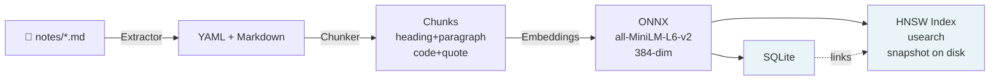
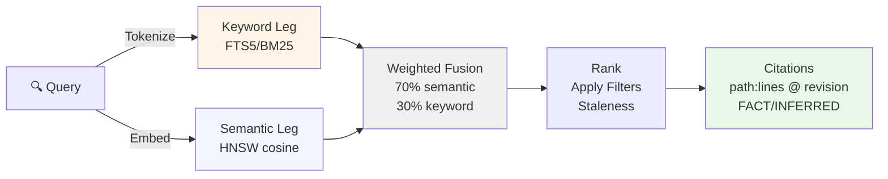

<div align="center" style="background-color: #f8f9fa; padding: 20px; border-radius: 10px; margin: 20px 0;">
  
</div>

# Plaesy: Memory

**Version:** 0.0.1

[](LICENSE) [](https://rust-lang.org/) [-orange.svg>)](VERSION)

Offline-first memory engine for AI agents: hybrid semantic + keyword retrieval over Markdown notes, where
**every result cites its source** and says how much the source itself can be trusted.

- Crate `plaesy`, module `plaesy::memory`
- Binary `memory`: index, search, links, hygiene, stats, watch, config, serve
  (JSON for Hermes, MCP for Claude Code / Cursor)
- Hermes provider: `hermes-plugin/plaesy-memory/` (core notes in prompt)

## How it works

### Write Path (Indexing)



### Read Path (Search)



Evidence rules, enforced in code and tests:

| Rule  | Behaviour                                                                                                                                        |
| ----- | ------------------------------------------------------------------------------------------------------------------------------------------------ |
| EV-01 | Every result carries file path, line range, git revision (if any) and index timestamp; `CitationBuilder::build` rejects results it cannot cite |
| EV-02 | `FACT` = lexical match in the source text, `INFERRED` = found by embedding similarity only                                                   |
| EV-03 | Result text is a verbatim slice of the source file, frontmatter chunks included (a unit test re-slices the file and compares)                    |
| NN-01 | No network at runtime, no API keys; models are downloaded once by `make model`                                                                 |

## What a source can say about itself

- **Tiers** (`core | episodic | semantic | procedural | archive`) filter retrieval; tier is inferred from the folder if omitted.
- **Staleness**: `last_verified` older than 180 days (configurable) flags the result `STALE` and multiplies its score by 0.85.
  It is down-weighted, never hidden. Episodic logs and archives do not go stale.
- **Status**: `superseded | deprecated | archived` notes are hidden unless `include_inactive`.
- **Trust filter**: `min_trust: high` keeps only sources that declare high confidence; undeclared is not "high".
- **Wikilinks**: `[[note]]` links are indexed (code fences, inline code and template directives ignored) for backlinks and dangling-link detection.
- **Hygiene**: `memory hygiene --strict` reports stale notes, missing metadata, broken links, superseded-without-replacement, and backticked paths that no longer exist (the last is a heuristic, labelled INFERRED). Read-only.

## Install (Windows, no developer tools after the build)

```powershell
cargo build --release                                         # the only step that needs Rust
powershell -ExecutionPolicy Bypass -File scripts\install.ps1  # copies memory.exe to PATH, then runs `memory onboard`
memory search "your question"
```

`install.ps1` needs only Windows PowerShell. It does not use Git Bash, `make` or `curl`. Use `-SkipOnboard` to skip
the setup questions, or `-BinaryPath` to install a `memory.exe` you already have.

### `memory onboard`

Run once after installing. It asks for the notes folder, writes `<root>\Plaesy\settings.json` (root defaults to
`%LOCALAPPDATA%`), downloads the embedding model (~90 MB) when it is missing, and indexes the notes. Every question has
a default, and `memory onboard --yes --vault "C:\path\to\vault"` answers them all without asking. Settings can be
changed later by running it again.

## Quick start

```bash
cargo build --release
make model                               # one-time ONNX download (~90 MB); `scripts/install-model.sh --rerank` adds the cross-encoder
target/release/memory index notes
target/release/memory search "how do we deploy" --tier procedural --min-trust medium
target/release/memory links runbook          # who links to it
target/release/memory hygiene notes --strict
```

```text
1. score 0.95  roles/researcher.md:58-60 [FACT] indexed 2026-10-18T17:25:19Z @ 576b7b5e… (tier semantic, trust high, verified 2026-10-01)
     - **Search & retrieval**: Web search for broad discovery; …
```

No model installed ⇒ keyword-only (a warning is logged; fake embeddings are never substituted silently).

## Integrations

```bash
# any MCP client (Claude Code / Desktop, Cursor, Hermes): query tools plus safe note writes, see docs/mcp.md
memory serve --mcp

# Hermes memory provider
make install-hermes-plugin && hermes config set memory.provider plaesy-memory
```

Hermes discovers memory providers one directory level under `plugins/`, hence `plugins/plaesy-memory/`, not `plugins/plaesy/memory/`.
Details: [docs/setup.md](docs/setup.md), [docs/mcp.md](docs/mcp.md), [docs/api.md](docs/api.md).

## Quality evidence

Everything below was measured on one machine (AMD Ryzen 7 5700U, CPU only) by this repository's own tests and benches.

**LongMemEval-S retrieval** ([dataset](https://huggingface.co/datasets/xiaowu0162/longmemeval-cleaned), session level; per question, a fresh index of its ~48 haystack sessions; abstention questions skipped).
Subset: every 5th of the 470 answerable questions = **94 questions**, not the full set (a full run is ~5 h on this CPU). Reproduce: `make lme DATA=longmemeval_s_cleaned.json STRIDE=5`.

| Mode                               | R@1   | R@3   | R@5             | R@10  | MRR   |
| ---------------------------------- | ----- | ----- | --------------- | ----- | ----- |
| keyword (FTS5/BM25)                | 0.798 | 0.904 | 0.936           | 0.979 | 0.861 |
| semantic (MiniLM)                  | 0.840 | 0.936 | 0.957           | 0.979 | 0.889 |
| **hybrid (default)**         | 0.840 | 0.926 | **0.968** | 0.979 | 0.891 |
| hybrid + cross-encoder, weight 0.5 | 0.840 | 0.936 | 0.979           | 0.979 | 0.897 |
| hybrid + cross-encoder, weight 0.7 | 0.862 | 0.936 | 0.968           | 0.979 | 0.908 |

Read this with care: with n = 94, one question is 1.1 points and the 95% interval on R@5 is roughly ±3.5, so hybrid vs semantic and
the reranker gains are **not statistically distinguishable**. Competitors' published figures (e.g. agentmemory BM25+MiniLM 95.2% R@5,
MemPalace 96.6% R@5) are self-reported on the full set with other settings; this table shows we are in the same range, not that we are ahead.
The weak spot is `single-session-preference` (R@5 0.83 hybrid, n = 6). Reranking is therefore **off by default**: it costs one
forward pass per candidate for no demonstrable gain at this sample size.

**Indonesian probe** (`scripts/id_probe.sh all-MiniLM-L6-v2 multilingual-e5-small`; notes and queries in `docs/eval/id-probe/`).
Eight notes written for this probe, eight paraphrased Indonesian queries labelled by the author. Top-1 / top-3 hit counts:

| Model                                         | semantic   | hybrid     |
| --------------------------------------------- | ---------- | ---------- |
| all-MiniLM-L6-v2 (default)                    | 4/8 · 6/8 | 6/8 · 7/8 |
| multilingual-e5-small (`MEMORY_MODEL_NAME`) | 7/8 · 8/8 | 6/8 · 8/8 |

This is a probe, not a benchmark: with n = 8 one query is 12.5 points, so treat the gap as a direction, not a result. The
default stays MiniLM until e5 is checked on English notes (LongMemEval, which is not yet run for e5).

**Latency** (`scripts/latency_probe.py <plugin binary>`; one client, sequential, 200 requests per mode, 20-document vault, same machine as above):
hybrid p50 2.7 ms / p95 4.2 ms; hybrid with `expand_links` p50 3.0 ms / p95 4.2 ms; keyword p50 1.1 ms / p95 1.8 ms.
The stdio protocol serves one request at a time per process, so no concurrent-load figure is given.

## Other checks

| What                                                  | Result                                                                                                                                                                        |
| ----------------------------------------------------- | ----------------------------------------------------------------------------------------------------------------------------------------------------------------------------- |
| Tests                                                 | 129 Rust tests (`cargo test`, all targets) + 7 Python shim tests (`make test-plugin`); real-ONNX tests run when models are installed. Counted 2026-10-20                  |
| Lint                                                  | `cargo clippy --all-targets -- -D warnings` and `cargo fmt --check` clean                                                                                                 |
| 20-doc/20-query labeled set (`make eval`)           | keyword 1.00 / 0.70 (lexical / paraphrase R@3) · semantic 1.00 / 1.00 · hybrid 1.00 / 1.00 (saturated; a regression guard only)                                             |
| Cold start, 4.6K chunks                               | 0.37 s with HNSW snapshot (was ~4 s)                                                                                                                                          |
| Indexing `.plaesy/` (145 files, 4 646 chunks, ONNX) | ~2 min 10 s, embedding-bound                                                                                                                                                  |
| Criterion                                             | HNSW top-10 search 0.18 ms / 2.8 ms / 3.9 ms at 1K / 10K / 50K random 384-d vectors; ONNX embed 11 ms single, 5.7 ms/text in a batch of 32; hybrid search 0.49 ms on 100 docs |

The design target "p50 < 1 ms on 100K vectors" is **not met** here (3.9 ms at 50K random vectors, a worst case for ANN; real-embedding latency unmeasured).

## Design & Research

**Retrieval strategy** (Weighted fusion, 70% semantic + 30% keyword):

- Hybrid outperforms semantic-only on LongMemEval-S (R@5 0.968 vs 0.957), though statistically equivalent at n=94 (CI ±3.5)
- Cross-encoder reranking off by default (costs 5 ms/hit for unmeasurable gain on this dataset)

**Embeddings** (ONNX, local):

- all-MiniLM-L6-v2 (384-dim, English, 86 MB): default for speed and maturity
- multilingual-e5-small (384-dim, 100+ languages, 200 MB): tested on Indonesian probe (7/8 vs 4/8 semantic for MiniLM); switch via `MEMORY_MODEL_NAME`
- No embeddings at runtime (all-MiniLM matches Microsoft, Oracle production guidance on CPU inference)

**Metadata filtering** (Unique to plaesy):

- Tier (core/episodic/semantic/procedural/archive), trust (high/medium/low), staleness (180-day penalty 0.85×)
- Validity windows (valid_from..valid_to dates) for time-bound claims
- Status (active/superseded/deprecated) for knowledge lifecycle

**Evidence rules** (EV-01 to EV-03, enforced in code and unit tests):

- Path, line range (1-based), git revision, timestamp on every result
- FACT (lexical) vs INFERRED (embedding) labels
- Verbatim text slices (re-slicing unit tests verify accuracy)

## Known Limits

- **English default model**: all-MiniLM-L6-v2. `multilingual-e5-small`
  available (`MEMORY_MODEL_NAME`, see
  [embeddings-guide](docs/embeddings-guide.md)) but not default yet.
- **Tokenization**: WordPiece (MiniLM) or SentencePiece (E5). Does not
  strip accents. E5 better for non-ASCII.
- **File types**: `.md`, `.markdown`, `.txt` only. Invalid YAML → plain
  text.
- **Concurrency**: One SQLite connection (local agents only).
- **Staleness**: Based on declared `last_verified`, not verification.
- **Metadata**: `read_only` / `limit` are conventions (not enforced).
- **ONNX**: Pinned to 2.0.0-rc.14 (stable pending).
- **Live testing**: Tested with scripts, not live Claude/Cursor/Hermes.

## Development

```bash
make verify        # build + test + python shim tests + clippy + fmt-check
make eval          # relevance table
make lme DATA=...  # LongMemEval-S
make bench         # criterion
```

## Documentation

**Start here**: [overview.md](docs/overview.md)
**Setup & models**: [setup.md](docs/setup.md), [embeddings-guide.md](docs/embeddings-guide.md)
**Development**: [architecture.md](docs/architecture.md), [api.md](docs/api.md), [mcp.md](docs/mcp.md)
**Internal research**: [.plaesy/memory/](.plaesy/memory/) (design decisions, deep-dives)

**User docs** (docs/):

- [overview.md](docs/overview.md) — Features, design principles, stack
- [setup.md](docs/setup.md) — Installation, onboarding
- [embeddings-guide.md](docs/embeddings-guide.md) — Model selection, performance, setup
- [api.md](docs/api.md) — Library + protocol reference
- [mcp.md](docs/mcp.md) — MCP integration (Claude Code, Cursor, n8n, Dify)
- [architecture.md](docs/architecture.md) — System design, modules

**Other**: [contributing.md](CONTRIBUTING.md), [changelog.md](CHANGELOG.md)

**Internal research** (.plaesy/memory/): Design decisions, deep-dives, competitor analysis

- [hybrid-retrieval-design.md](.plaesy/memory/hybrid-retrieval-design.md)
- [components-architecture.md](.plaesy/memory/components-architecture.md)
- [competitor-research.md](.plaesy/memory/competitor-research.md)
